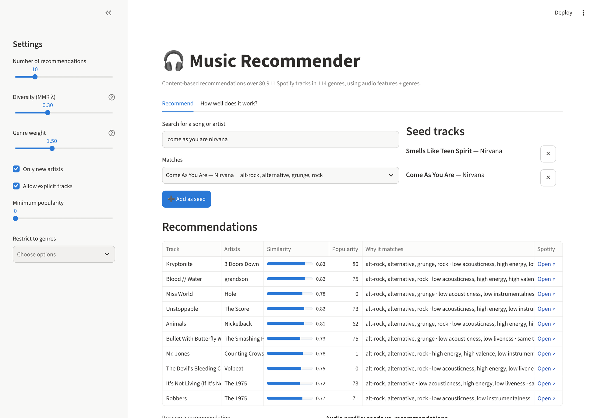

# 🎧 Music Recommender

[](https://github.com/meetkothari-08/Music-Recommendation/actions/workflows/ci.yml)


A content-based music recommender built on **80,695 Spotify tracks across 114 genres**. It covers
the whole workflow: a data-cleaning pipeline, feature engineering, a kNN model with
diversity-aware re-ranking, an **offline evaluation against baselines**, and an interactive
Streamlit app that explains every recommendation.



## Results at a glance

The model gets 3 songs by an artist it has never been told about and has to find that artist's
other songs among all 80k tracks. Tested on 1,000 held-out artists:

| Model | HitRate@10 | NDCG@10 | Diversity |
|---|---:|---:|---:|
| Random | 0.001 | 0.000 | 0.951 |
| Most popular | 0.001 | 0.000 | 0.809 |
| Most popular in the seeds' genres | 0.073 | 0.013 | 0.667 |
| Audio features only (kNN) | 0.127 | 0.027 | 0.080 |
| Audio + genre embedding | 0.467 | 0.117 | 0.184 |
| Audio + one-hot genre | 0.500 | 0.139 | 0.199 |
| **Audio + one-hot genre + MMR re-ranking (final)** | **0.540** | **0.144** | **0.237** |

- The final model finds at least one hidden song for **54% of artists**, which is **7.4x the best
  simple baseline**.
- Diversity re-ranking (MMR) makes lists **19% more diverse with no loss in accuracy**; hit rate
  actually goes up (0.500 → 0.540).
- Recommendations average **popularity 35, versus 97 for the popularity baseline**, so the model
  surfaces long-tail tracks rather than just the hits.

Full report with confidence intervals, ablations and sweeps: [`reports/evaluation.md`](reports/evaluation.md).

## How it works

```
raw CSV (114k rows) ──► clean ──► 80.7k unique songs ──► feature vectors ──► cosine kNN ──► MMR re-rank ──► top-k + explanations
```

### 1. Data cleaning ([`data.py`](src/music_recommender/data.py))
The raw dataset was built by sampling ~1,000 tracks *per genre*, which leaves duplicates a
recommender has to handle:

| Step | Rows removed |
|---|---:|
| Missing title/artist | 1 |
| Failed audio analysis (`tempo = 0`) or non-song durations (<30s, >15min) | 322 |
| Same `track_id` listed under several genres → one row, genres merged | 24,245 |
| Same recording re-released (single, album, "Remastered 2011", mono…) → keep most popular, merge genres | 8,737 |

Without this step, the model would recommend the seed song straight back to the user. Live,
acoustic and remix versions sound different, so they stay as separate songs. They are grouped,
though, and the recommender never suggests another version of a song you seeded.

### 2. Feature engineering ([`features.py`](src/music_recommender/features.py))
- **Audio block:** 10 Spotify audio features (energy, valence, acousticness, tempo, …). Several are
  heavily skewed (speechiness has skew 4.5), so instead of plain z-scoring they go through a
  **quantile transform to a normal distribution**, which keeps outliers from dominating distances.
- **Genre block:** I compared two options: one-hot genres, and a **learned genre embedding**
  (positive PMI on genre co-occurrence + truncated SVD), which places related genres like
  `punk`/`punk-rock` close together.
- Each block is scaled to unit length and weighted, so a single `genre_weight` parameter sets how
  much genre counts compared with sound.

### 3. Model ([`recommender.py`](src/music_recommender/recommender.py))
- Several seed songs are averaged into one **taste profile**, so the model also works for
  playlist continuation.
- **Brute-force cosine kNN** on L2-normalised vectors (about 16 ms per query over 80k tracks; no ANN
  index is needed at this scale).
- **Maximal Marginal Relevance** re-ranking trades a little similarity for variety, so a list isn't
  ten near-identical songs.
- **Explanations:** each recommendation lists its shared genres, plus the audio traits that make the
  seeds stand out from the catalogue *and* that the recommendation shares (e.g. "high energy, low
  acousticness"). Traits that nearly every track has are left out.
- Filters: new artists only, no explicit tracks, minimum popularity, restrict to genres.

### 4. Evaluation ([`evaluation.py`](src/music_recommender/evaluation.py))
There are no user listening logs, so I evaluate with an **artist-continuation** task. Artist is
never a model feature, so the model can only succeed by picking up an artist's sound and style. To
avoid overfitting the reported numbers:
- hyper-parameters (genre weight, representation, MMR λ) are **tuned on a validation draw** of
  artists;
- final numbers come from a **separate test draw**, with 95% confidence intervals;
- beyond-accuracy metrics (diversity, catalogue coverage, popularity bias) are tracked alongside
  accuracy;
- other versions of the seed songs (e.g. a live recording) never count as hits, because the
  recommender excludes them. This closed a small leak that inflated an earlier version of these
  results.

## Findings

1. **Audio alone isn't enough.** Audio-only kNN beats random by a wide margin but reaches only
   0.127 HitRate. Neighbouring genres (pop vs. r-n-b, edm vs. techno) sound very similar
   ([EDA](notebooks/01_eda.ipynb)).
2. **Genre is the strongest single signal.** Adding it lifts HitRate from 0.13 to 0.50. Performance
   levels off above a weight of about 1 ([sweep](reports/figures/genre_weight_sweep.png)).
3. **The learned genre embedding lost to one-hot (0.467 vs 0.500 HitRate).** In the EDA, some
   co-occurring genre pairs look like collection artefacts (`dub`/`dubstep`,
   `reggae`/`reggaeton`), so the embedding partly learns noise. Its upside is that about 5% of its
   recommendations cross genre lines, which is useful when discovery matters more than precision.
4. **Some diversity is free.** MMR at λ = 0.3 raises both diversity and accuracy. Past λ ≈ 0.4,
   accuracy drops sharply ([sweep](reports/figures/diversity_sweep.png)).

## Quickstart

```bash
git clone https://github.com/meetkothari-08/Music-Recommendation.git
```

```bash
cd Music-Recommendation
```

```bash
python -m venv .venv && source .venv/bin/activate
```

```bash
pip install -e ".[dev,notebook]"
```

```bash
music-rec build
```

```bash
streamlit run app/streamlit_app.py
```

`music-rec build` downloads the [public dataset](https://huggingface.co/datasets/maharshipandya/spotify-tracks-dataset)
(20 MB) from Hugging Face and writes `data/processed/tracks.parquet`. The app runs this step
automatically on first launch if needed.

Other commands:

```bash
music-rec recommend "smells like teen spirit" "come as you are nirvana" -k 10 --new-artists
```

```bash
music-rec evaluate
```

```bash
pytest
```

`music-rec evaluate` regenerates everything in `reports/` (it takes about 30 seconds). The
[`Makefile`](Makefile) has shortcuts for these (`make data`, `make app`, `make evaluate`, `make test`).

### Deploy for free
The repo is ready for [Streamlit Community Cloud](https://streamlit.io/cloud): create a new app,
point it at this repository and choose `app/streamlit_app.py` as the main file.
`requirements.txt` installs the package.

## Project structure

```
├── app/streamlit_app.py           # interactive UI
├── notebooks/01_eda.ipynb         # exploratory analysis → modelling decisions
├── reports/                       # generated evaluation report, CSVs and figures
├── src/music_recommender/
│   ├── config.py                  # paths, feature lists
│   ├── data.py                    # download + cleaning pipeline (with audit trail)
│   ├── features.py                # quantile-scaled audio + genre one-hot / PPMI-SVD embedding
│   ├── recommender.py             # kNN + MMR re-ranking + explanations + filters
│   ├── evaluation.py              # artist-continuation task, metrics, baselines, sweeps
│   ├── reporting.py               # writes reports/evaluation.md and figures
│   └── cli.py                     # `music-rec` command
├── tests/                         # pytest suite on synthetic data (no download needed)
└── .github/workflows/ci.yml       # lint + tests on Python 3.10 and 3.12
```

## Limitations and next steps

- **No interaction data.** Content-based filtering can't learn that people who like X also like Y
  when X and Y sound different. The natural next step is a hybrid with collaborative filtering
  (e.g. implicit ALS) trained on playlist data such as the Spotify Million Playlist Dataset.
- **The evaluation is a proxy.** Counting only same-artist songs as hits means good
  recommendations by similar artists score as misses, so absolute numbers understate quality.
  Comparisons between models are what the task is for.
- **Static catalogue.** Spotify closed its audio-features API to new apps in late 2024, so the
  catalogue can't grow from the live API. New tracks would need audio embeddings computed from
  previews (e.g. a pretrained audio model).

## Tech stack
Python · pandas · NumPy · scikit-learn · Streamlit · Altair · Matplotlib · pytest · Ruff · GitHub Actions
