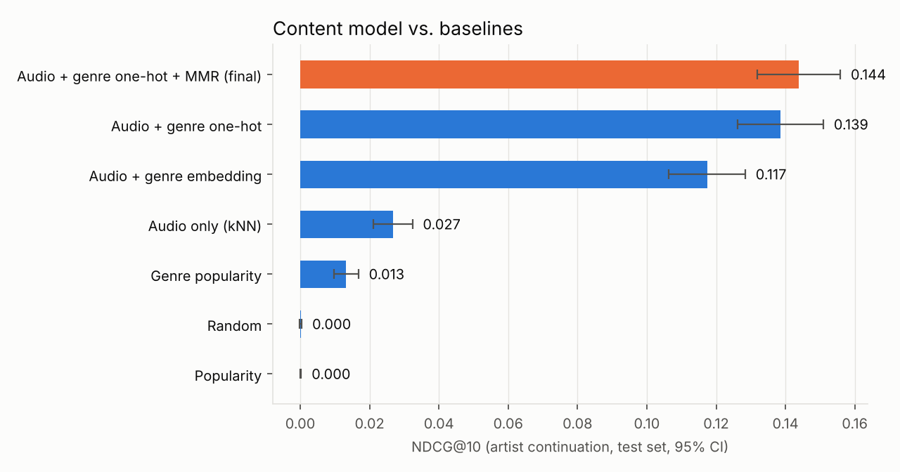
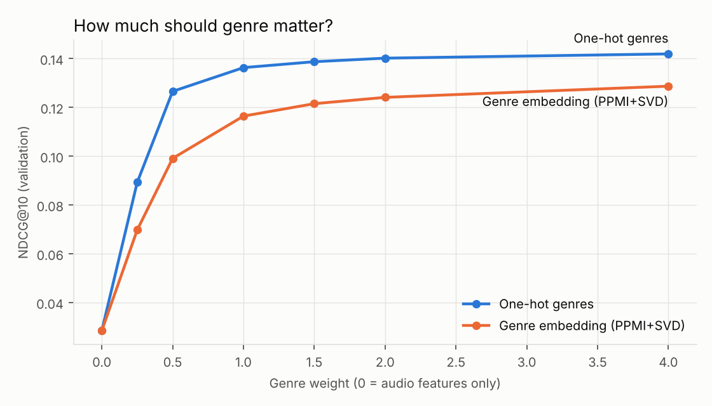
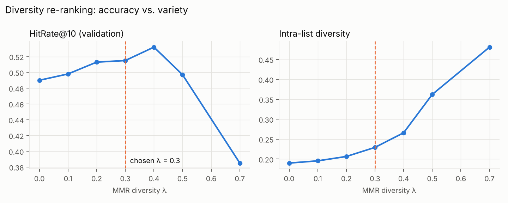

# Offline evaluation

Generated by `music-rec evaluate`. Do not edit by hand.

**Task:** artist continuation - 1000 artists with ≥6 songs; the model sees 3 songs and must retrieve the artist's hidden songs in its top 10 out of 80,695 tracks. Artist is never a model feature.

**Protocol:** hyper-parameters were tuned on a *validation* draw of artists (seed 7); the comparison below is on a separate *test* draw (seed 42).

## Model comparison (test set)

| Model                               |   HitRate@10 |   Recall@10 |   NDCG@10 |   NDCG ±95% CI |   Genre precision |   Diversity |   Coverage |   Avg popularity |
|:------------------------------------|-------------:|------------:|----------:|---------------:|------------------:|------------:|-----------:|-----------------:|
| Random                              |        0.001 |       0.000 |     0.000 |          0.000 |             0.015 |       0.951 |      0.115 |           42.446 |
| Popularity                          |        0.001 |       0.000 |     0.000 |          0.000 |             0.019 |       0.809 |      0.000 |           97.200 |
| Genre popularity                    |        0.073 |       0.014 |     0.013 |          0.004 |             1.000 |       0.667 |      0.012 |           70.668 |
| Audio only (kNN)                    |        0.127 |       0.026 |     0.027 |          0.006 |             0.184 |       0.080 |      0.111 |           34.542 |
| Audio + genre embedding             |        0.467 |       0.121 |     0.117 |          0.011 |             0.947 |       0.184 |      0.109 |           34.778 |
| Audio + genre one-hot               |        0.500 |       0.142 |     0.139 |          0.012 |             1.000 |       0.199 |      0.110 |           34.926 |
| Audio + genre one-hot + MMR (final) |        0.540 |       0.151 |     0.144 |          0.012 |             1.000 |       0.237 |      0.112 |           34.789 |

## Genre weight and representation (validation set)

| Genres    |   Weight |   HitRate@10 |   NDCG@10 |   Genre precision |   Diversity |
|:----------|---------:|-------------:|----------:|------------------:|------------:|
| onehot    |    0.000 |        0.151 |     0.028 |             0.194 |       0.079 |
| onehot    |    0.250 |        0.372 |     0.089 |             0.717 |       0.102 |
| onehot    |    0.500 |        0.486 |     0.127 |             0.994 |       0.152 |
| onehot    |    1.000 |        0.487 |     0.136 |             1.000 |       0.177 |
| onehot    |    1.500 |        0.490 |     0.139 |             1.000 |       0.190 |
| onehot    |    2.000 |        0.491 |     0.140 |             1.000 |       0.197 |
| onehot    |    4.000 |        0.495 |     0.142 |             1.000 |       0.206 |
| embedding |    0.000 |        0.151 |     0.028 |             0.194 |       0.079 |
| embedding |    0.250 |        0.306 |     0.070 |             0.592 |       0.102 |
| embedding |    0.500 |        0.403 |     0.099 |             0.818 |       0.132 |
| embedding |    1.000 |        0.442 |     0.116 |             0.920 |       0.160 |
| embedding |    1.500 |        0.452 |     0.122 |             0.950 |       0.176 |
| embedding |    2.000 |        0.466 |     0.124 |             0.964 |       0.185 |
| embedding |    4.000 |        0.471 |     0.129 |             0.981 |       0.200 |

## MMR diversity (validation set)

|     λ |   HitRate@10 |   NDCG@10 |   Diversity |   Coverage |
|------:|-------------:|----------:|------------:|-----------:|
| 0.000 |        0.490 |     0.139 |       0.190 |      0.110 |
| 0.100 |        0.498 |     0.140 |       0.196 |      0.110 |
| 0.200 |        0.513 |     0.142 |       0.206 |      0.110 |
| 0.300 |        0.515 |     0.141 |       0.229 |      0.111 |
| 0.400 |        0.532 |     0.137 |       0.266 |      0.113 |
| 0.500 |        0.497 |     0.113 |       0.362 |      0.114 |
| 0.700 |        0.385 |     0.081 |       0.481 |      0.113 |

## Metric definitions

- **HitRate@10** - share of tasks where at least one hidden song is recommended.
- **Recall@10** - hidden songs retrieved / min(#hidden, 10).
- **NDCG@10** - rank-aware: hits near the top count more.
- **Genre precision** - share of recommendations sharing a genre with the seeds.
- **Diversity** - mean pairwise cosine distance of recommendations in audio-feature space.
- **Coverage** - share of the catalogue recommended at least once across all tasks.
- **Avg popularity** - mean Spotify popularity (0-100) of recommendations; lower = less popularity bias.
