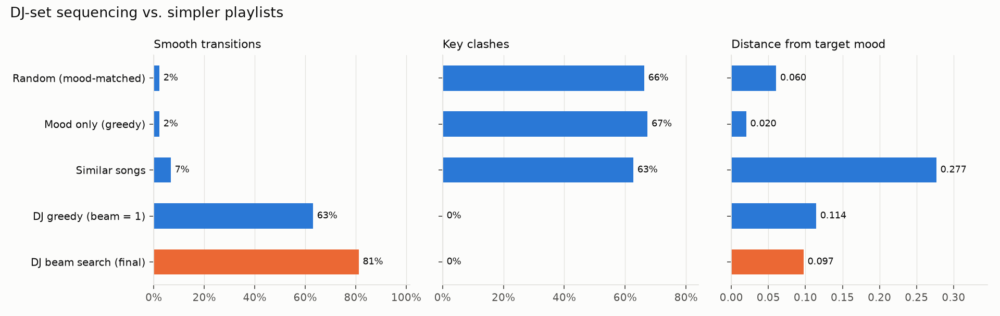

# Offline evaluation

Generated by `music-rec evaluate`. Do not edit by hand.

**Task:** artist continuation - 1000 artists with ≥6 songs; the model sees 3 songs and must retrieve the artist's hidden songs in its top 10 out of 80,695 tracks. Artist is never a model feature.

**Protocol:** hyper-parameters were tuned on a *validation* draw of artists (seed 7); the comparison below is on a separate *test* draw (seed 42).

## Model comparison (test set)

| Model                               |   HitRate@10 |   Recall@10 |   NDCG@10 |   NDCG ±95% CI |   Genre precision |   Diversity |   Coverage |   Avg popularity |
|:------------------------------------|-------------:|------------:|----------:|---------------:|------------------:|------------:|-----------:|-----------------:|
| Random                              |        0.001 |       0.000 |     0.000 |          0.000 |             0.013 |       0.948 |      0.115 |           42.446 |
| Popularity                          |        0.001 |       0.000 |     0.000 |          0.000 |             0.020 |       0.801 |      0.000 |           97.200 |
| Genre popularity                    |        0.072 |       0.014 |     0.013 |          0.004 |             1.000 |       0.671 |      0.012 |           70.669 |
| Audio only (kNN)                    |        0.123 |       0.025 |     0.025 |          0.005 |             0.178 |       0.081 |      0.112 |           34.410 |
| Audio + genre embedding             |        0.470 |       0.122 |     0.119 |          0.011 |             0.949 |       0.185 |      0.109 |           34.822 |
| Audio + genre one-hot               |        0.500 |       0.142 |     0.138 |          0.012 |             1.000 |       0.199 |      0.110 |           34.766 |
| Audio + genre one-hot + MMR (final) |        0.527 |       0.147 |     0.140 |          0.012 |             1.000 |       0.239 |      0.112 |           34.727 |

## Genre weight and representation (validation set)

| Genres    |   Weight |   HitRate@10 |   NDCG@10 |   Genre precision |   Diversity |
|:----------|---------:|-------------:|----------:|------------------:|------------:|
| onehot    |    0.000 |        0.137 |     0.027 |             0.192 |       0.079 |
| onehot    |    0.250 |        0.364 |     0.088 |             0.713 |       0.102 |
| onehot    |    0.500 |        0.482 |     0.128 |             0.996 |       0.151 |
| onehot    |    1.000 |        0.489 |     0.138 |             1.000 |       0.179 |
| onehot    |    1.500 |        0.496 |     0.140 |             1.000 |       0.191 |
| onehot    |    2.000 |        0.500 |     0.141 |             1.000 |       0.198 |
| onehot    |    4.000 |        0.494 |     0.142 |             1.000 |       0.207 |
| embedding |    0.000 |        0.137 |     0.027 |             0.192 |       0.079 |
| embedding |    0.250 |        0.304 |     0.069 |             0.592 |       0.102 |
| embedding |    0.500 |        0.387 |     0.097 |             0.818 |       0.132 |
| embedding |    1.000 |        0.431 |     0.112 |             0.919 |       0.161 |
| embedding |    1.500 |        0.449 |     0.119 |             0.946 |       0.176 |
| embedding |    2.000 |        0.465 |     0.122 |             0.961 |       0.185 |
| embedding |    4.000 |        0.472 |     0.130 |             0.980 |       0.202 |

## MMR diversity (validation set)

|     λ |   HitRate@10 |   NDCG@10 |   Diversity |   Coverage |
|------:|-------------:|----------:|------------:|-----------:|
| 0.000 |        0.496 |     0.140 |       0.191 |      0.110 |
| 0.100 |        0.503 |     0.142 |       0.197 |      0.110 |
| 0.200 |        0.514 |     0.143 |       0.208 |      0.111 |
| 0.300 |        0.520 |     0.142 |       0.230 |      0.111 |
| 0.400 |        0.535 |     0.137 |       0.268 |      0.113 |
| 0.500 |        0.472 |     0.108 |       0.361 |      0.115 |
| 0.700 |        0.359 |     0.079 |       0.477 |      0.113 |

## DJ-set sequencing

**Task:** 200 random set requests (random start and end mood, arc, and half of them restricted to one genre), 10 tracks each. Every method's track order is scored by the same transition rules (tempo within 6%, Camelot-compatible keys).

| Method                 |   Smooth transitions |   ±95% CI |   Mixable |   Key clashes |   Avg tempo change % |   Avg energy jump |   Mood error |   Genre coherence |   ms per set |
|:-----------------------|---------------------:|----------:|----------:|--------------:|---------------------:|------------------:|-------------:|------------------:|-------------:|
| Random (mood-matched)  |                0.022 |     0.007 |     0.061 |         0.662 |               16.868 |             0.064 |        0.060 |             0.437 |       15.039 |
| Mood only (greedy)     |                0.022 |     0.007 |     0.059 |         0.673 |               17.188 |             0.051 |        0.020 |             0.422 |       13.711 |
| Similar songs          |                0.067 |     0.010 |     0.143 |         0.627 |               12.745 |             0.124 |        0.277 |             1.000 |       12.034 |
| DJ greedy (beam = 1)   |                0.631 |     0.025 |     1.000 |         0.000 |                1.943 |             0.076 |        0.114 |             0.849 |       22.398 |
| DJ beam search (final) |                0.812 |     0.024 |     1.000 |         0.000 |                1.521 |             0.066 |        0.097 |             0.983 |      115.491 |

## Metric definitions

- **HitRate@10** - share of tasks where at least one hidden song is recommended.
- **Recall@10** - hidden songs retrieved / min(#hidden, 10).
- **NDCG@10** - rank-aware: hits near the top count more.
- **Genre precision** - share of recommendations sharing a genre with the seeds.
- **Diversity** - mean pairwise cosine distance of recommendations in audio-feature space.
- **Coverage** - share of the catalogue recommended at least once across all tasks.
- **Avg popularity** - mean Spotify popularity (0-100) of recommendations; lower = less popularity bias.
- **Smooth transitions** - tempo change ≤ 6%, compatible keys and transition score ≥ 75/100.
- **Mixable** - tempo change ≤ 6% and keys that don't clash, even if not rated smooth.
- **Mood error** - mean distance between each track and its target (valence, energy).
- **Genre coherence** - share of consecutive tracks that share at least one genre.
