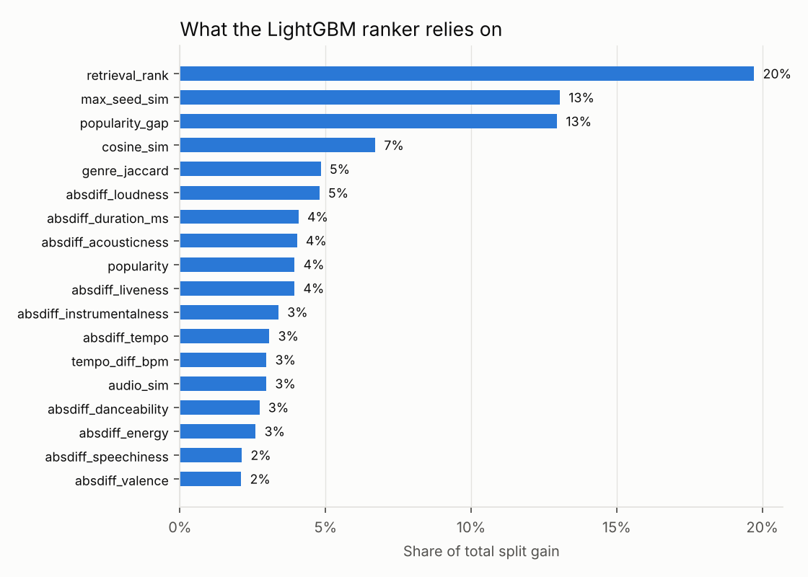

# Offline evaluation

Generated by `music-rec evaluate`. Do not edit by hand.

**Task:** artist continuation - 1000 artists with ≥6 songs; the model sees 3 songs and must retrieve the artist's hidden songs in its top 10 out of 80,911 tracks. Artist is never a model feature.

**Protocol:** hyper-parameters were tuned on a *validation* draw of artists (seed 7); the comparison below is on a separate *test* draw (seed 42).

## Model comparison (test set)

| Model                                  |   HitRate@10 |   Recall@10 |   NDCG@10 |   NDCG ±95% CI |   Genre precision |   Diversity |   Coverage |   Avg popularity |
|:---------------------------------------|-------------:|------------:|----------:|---------------:|------------------:|------------:|-----------:|-----------------:|
| Random                                 |        0.003 |       0.000 |     0.001 |          0.001 |             0.017 |       0.943 |      0.115 |           42.450 |
| Popularity                             |        0.001 |       0.000 |     0.000 |          0.000 |             0.026 |       0.813 |      0.000 |           97.200 |
| Genre popularity                       |        0.071 |       0.013 |     0.012 |          0.004 |             1.000 |       0.671 |      0.012 |           71.136 |
| Audio only (kNN)                       |        0.126 |       0.024 |     0.024 |          0.005 |             0.189 |       0.083 |      0.110 |           34.607 |
| Audio + genre embedding                |        0.471 |       0.124 |     0.123 |          0.011 |             0.944 |       0.181 |      0.108 |           35.289 |
| Audio + genre one-hot                  |        0.508 |       0.148 |     0.145 |          0.013 |             1.000 |       0.197 |      0.110 |           35.069 |
| Audio + genre one-hot + MMR (final)    |        0.534 |       0.153 |     0.148 |          0.012 |             1.000 |       0.237 |      0.111 |           35.055 |
| Two-stage: retrieval + LightGBM ranker |        0.614 |       0.201 |     0.197 |          0.015 |             1.000 |       0.284 |      0.113 |           34.764 |

## Two-stage retrieve-then-rank (LightGBM)

**Stage 1** retrieves the 200 nearest tracks with the content model (MMR off). **Stage 2** re-scores them with a LightGBM `LGBMRanker` (lambdarank) on candidate features: overall / audio-only / best-single-seed cosine similarity, genre Jaccard, absolute per-feature differences to the seed profile, tempo difference, popularity, popularity gap to the seeds and stage-1 rank. Artist and album fields are never features.

**Training data:** 3,558 queries from 1,848 artists that appear in neither the validation nor the test tasks (1,699 artists excluded); label = candidate is by the seed artist, group = query. Queries with no positive candidate are dropped.

**Stage-1 ceiling:** for 96.6% of test tasks at least one hidden song is among the 200 candidates, so that is the ranker's maximum HitRate.

**Paired difference vs. the final content model on the same test tasks** (per-task mean, 95% CI):

- NDCG@10: +0.048 ± 0.010 (ranker better on 428 tasks, worse on 237)
- HitRate@10: +0.080 ± 0.030

Caveat: the ranker is trained to retrieve *same-artist* songs, i.e. it is optimised for exactly this proxy task. Some of what it learns (e.g. that an artist's songs have similar popularity) helps the proxy more than it would help real listeners.

### MMR after the ranker (validation set)

Chosen λ = 0.3 (best validation NDCG@10).

|     λ |   HitRate@10 |   NDCG@10 |   Diversity |   Avg popularity |
|------:|-------------:|----------:|------------:|-----------------:|
| 0.000 |        0.627 |     0.207 |       0.263 |           35.983 |
| 0.100 |        0.627 |     0.207 |       0.267 |           35.973 |
| 0.200 |        0.630 |     0.208 |       0.272 |           35.988 |
| 0.300 |        0.632 |     0.208 |       0.278 |           35.991 |
| 0.400 |        0.629 |     0.208 |       0.285 |           35.941 |
| 0.500 |        0.630 |     0.207 |       0.295 |           35.938 |

### Feature-group ablation (validation set, no MMR)

| Ranker                            |   HitRate@10 |   NDCG@10 |   Diversity |   Avg popularity |
|:----------------------------------|-------------:|----------:|------------:|-----------------:|
| Stage 1 alone (no ranker, no MMR) |        0.530 |     0.152 |       0.195 |           35.914 |
| All features                      |        0.627 |     0.207 |       0.263 |           35.983 |
| Without popularity features       |        0.586 |     0.189 |       0.251 |           36.079 |
| Without max_seed_sim              |        0.620 |     0.201 |       0.262 |           35.998 |
| Stage-1 score + rank only         |        0.522 |     0.144 |       0.209 |           35.915 |

### Feature importance

## Genre weight and representation (validation set)

| Genres    |   Weight |   HitRate@10 |   NDCG@10 |   Genre precision |   Diversity |
|:----------|---------:|-------------:|----------:|------------------:|------------:|
| onehot    |    0.000 |        0.157 |     0.029 |             0.201 |       0.080 |
| onehot    |    0.250 |        0.390 |     0.093 |             0.725 |       0.106 |
| onehot    |    0.500 |        0.516 |     0.135 |             0.993 |       0.153 |
| onehot    |    1.000 |        0.531 |     0.150 |             1.000 |       0.181 |
| onehot    |    1.500 |        0.530 |     0.152 |             1.000 |       0.195 |
| onehot    |    2.000 |        0.527 |     0.155 |             1.000 |       0.203 |
| onehot    |    4.000 |        0.518 |     0.156 |             1.000 |       0.213 |
| embedding |    0.000 |        0.157 |     0.029 |             0.201 |       0.080 |
| embedding |    0.250 |        0.342 |     0.075 |             0.606 |       0.105 |
| embedding |    0.500 |        0.432 |     0.106 |             0.833 |       0.137 |
| embedding |    1.000 |        0.474 |     0.122 |             0.925 |       0.165 |
| embedding |    1.500 |        0.491 |     0.128 |             0.953 |       0.179 |
| embedding |    2.000 |        0.498 |     0.135 |             0.964 |       0.188 |
| embedding |    4.000 |        0.502 |     0.143 |             0.981 |       0.206 |

## MMR diversity (validation set)

|     λ |   HitRate@10 |   NDCG@10 |   Diversity |   Coverage |
|------:|-------------:|----------:|------------:|-----------:|
| 0.000 |        0.530 |     0.152 |       0.195 |      0.109 |
| 0.100 |        0.532 |     0.154 |       0.200 |      0.109 |
| 0.200 |        0.546 |     0.156 |       0.212 |      0.110 |
| 0.300 |        0.559 |     0.158 |       0.234 |      0.111 |
| 0.400 |        0.560 |     0.155 |       0.275 |      0.112 |
| 0.500 |        0.535 |     0.129 |       0.366 |      0.113 |
| 0.700 |        0.393 |     0.090 |       0.478 |      0.112 |

## Metric definitions

- **HitRate@10** - share of tasks where at least one hidden song is recommended.
- **Recall@10** - hidden songs retrieved / min(#hidden, 10).
- **NDCG@10** - rank-aware: hits near the top count more.
- **Genre precision** - share of recommendations sharing a genre with the seeds.
- **Diversity** - mean pairwise cosine distance of recommendations in audio-feature space.
- **Coverage** - share of the catalogue recommended at least once across all tasks.
- **Avg popularity** - mean Spotify popularity (0-100) of recommendations; lower = less popularity bias.
